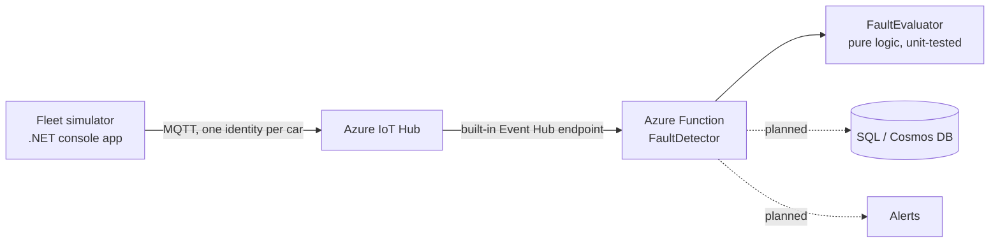

# Telematrack

**Automotive telemetry & predictive maintenance platform.** A cloud pipeline that ingests simulated vehicle data, detects faults, and (soon) stores and alerts on them. Built with .NET, Azure and Terraform.

> **Status: work in progress.** The simulator, the fault-detection logic and its unit tests run locally today. The Azure infrastructure is written and passes `terraform validate`, but it has **not been deployed yet** (no Azure subscription available so far). The [Status](#status) table says exactly what is and isn't verified.

## Architecture



## Repository layout

| Folder | Contents |
|---|---|
| `simulator/` | Console app that simulates a small fleet sending OBD-II style JSON telemetry |
| `functions/` | Azure Function (.NET 8, isolated worker) that reads the telemetry stream and evaluates faults |
| `tests/` | xUnit tests for the fault-evaluation rules |
| `infra/` | Terraform: resource group, IoT Hub, consumer group, Function App and its storage |

## Status

| Piece | State |
|---|---|
| Fleet simulator, dry-run mode (prints JSON) | Working |
| Simulator to IoT Hub sender | Written and compiles; **not yet tested against a live hub** |
| `FaultEvaluator` and unit tests | Working |
| Azure Function (`FaultDetector`) | Builds; not deployed |
| Terraform (IoT Hub, consumer group, Function App) | Passes `terraform validate`; never applied |
| Storage (SQL or Cosmos DB) and alerting | Planned |
| CI/CD (fmt, validate, tfsec, tests, deploy) | Planned |

## How it works

1. The simulator generates readings (RPM, oil temperature, speed, optional fault code) for each vehicle and serializes them as compact camelCase JSON.
2. In real mode, each vehicle connects to IoT Hub with its **own device identity** and sends the JSON over MQTT.
3. The Function reads the hub's built-in Event Hub endpoint and passes each reading to `FaultEvaluator`.
4. `FaultEvaluator` returns `None`, `Warning` or `Critical`; warnings and criticals are logged as alerts.

### Fault rules

| Condition | Severity |
|---|---|
| `P0300` (random misfire) | Warning |
| `P0171` (system too lean) | Warning |
| `P1A57` (**simulated** rotary apex seal warning, not a real OBD-II code) | Critical |
| Any fault code the system doesn't recognize | Warning |
| Oil temperature above 115 °C | Warning |
| Blank or missing fault code and normal temperature | None |

## Design decisions

- **Per-device identity.** Each car has its own credentials, so one compromised device can be revoked without touching the fleet.
- **Least privilege.** The Function reads telemetry through the hub's `service` policy, not the all-powerful `iothubowner` key.
- **Fail-safe defaults.** An unrecognized fault code escalates to a warning instead of being silently ignored.
- **Secrets stay out of the repo.** Device connection strings are read from environment variables only; Terraform state and the provider cache are git-ignored.
- **Logic is separate from plumbing.** `FaultEvaluator` has no Azure dependencies, so it is unit-tested offline.
- **Free-tier budget.** The simulator defaults to one round every 60 seconds: 3 cars × 1,440 minutes = 4,320 messages/day, under the IoT Hub free tier's 8,000/day cap.

## Run it locally

Prerequisites: .NET SDK 10, Terraform.

```powershell
# Simulator in dry-run mode (prints JSON, sends nothing)
$env:SIMULATOR_INTERVAL_SECONDS = "2"   # optional: faster output for testing
dotnet run --project simulator

# Unit tests
dotnet test tests

# Validate the infrastructure code (needs no Azure account)
cd infra
terraform init
terraform validate
```

### Real mode (needs a deployed IoT Hub)

Register one device per vehicle, then provide each device connection string through an environment variable named after the vehicle ID, with hyphens replaced by underscores:

```powershell
$env:IOTHUB_CS_FC_RX7_001 = "<device connection string>"
$env:IOTHUB_CS_AE86_002   = "<device connection string>"
$env:IOTHUB_CS_GT_R32_003 = "<device connection string>"
dotnet run --project simulator
```

If only some of the variables are set, the simulator refuses to start rather than half-running.

## Roadmap

- [ ] Store readings (SQL or Cosmos DB) and trigger a real alert on critical faults
- [ ] GitHub Actions: format check, `terraform validate`, `tfsec`, unit tests
- [ ] Deploy the infrastructure from CI and verify the sender end to end

## Author

Built by Djiby as a learning project and portfolio piece.
