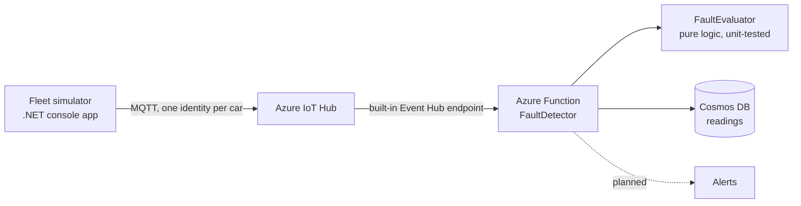

# Telematrack

**Automotive telemetry & predictive maintenance platform.** A cloud pipeline that ingests simulated vehicle data, detects faults and stores every reading. Built with .NET, Azure and Terraform.

> **Status: work in progress.** The simulator, the fault detection and the Cosmos DB storage layer run and are tested locally (the storage layer against the Cosmos DB emulator). The Azure infrastructure is written and passes `terraform validate`, but it has **not been deployed** (no Azure subscription yet), so the full hub → Function → database path has not been run end to end. The [Status](#status) table says exactly what is and isn't verified.

## Architecture



## Repository layout

| Folder | Contents |
|---|---|
| `simulator/` | Console app that simulates a small fleet sending OBD-II style JSON telemetry |
| `functions/` | Azure Function (.NET 8, isolated worker): fault evaluation and the Cosmos DB repository |
| `tests/` | xUnit unit tests, plus integration tests that run against the Cosmos DB emulator |
| `infra/` | Terraform: resource group, IoT Hub, consumer group, Function App, Cosmos DB |

## Status

| Piece | State |
|---|---|
| Fleet simulator, dry-run mode (prints JSON) | Working |
| Simulator to IoT Hub sender | Written and compiles; **not yet tested against a live hub** |
| `FaultEvaluator` and unit tests | Working |
| Cosmos DB repository (`ReadingRepository`) | Working; **verified against the local Cosmos DB emulator** by integration tests |
| Azure Function (`FaultDetector`) | Builds; **never run end to end** (hub trigger → repository) |
| Terraform (IoT Hub, Function App, Cosmos DB) | Passes `terraform validate`; never applied |
| Alerting | Planned |
| CI/CD (fmt, validate, tfsec, tests, deploy) | Planned |

## How it works

1. The simulator generates readings (RPM, oil temperature, speed, optional fault code) for each vehicle and serializes them as compact camelCase JSON.
2. In real mode, each vehicle connects to IoT Hub with its **own device identity** and sends the JSON over MQTT.
3. The Function reads the hub's built-in Event Hub endpoint and passes each reading to `FaultEvaluator`.
4. `FaultEvaluator` returns `None`, `Warning` or `Critical`; warnings and criticals are logged as alerts.
5. Every reading, alert or not, is saved to Cosmos DB with its alert level.

### Fault rules

| Condition | Severity |
|---|---|
| `P0300` (random misfire) | Warning |
| `P0171` (system too lean) | Warning |
| `P1A57` (**simulated** rotary apex seal warning, not a real OBD-II code) | Critical |
| Any fault code the system doesn't recognize | Warning |
| Oil temperature above 115 °C | Warning |
| Blank or missing fault code and normal temperature | None |

### Data model (Cosmos DB)

| Aspect | Choice |
|---|---|
| Document id | `{vehicleId}_{timestamp ticks}`, deterministic |
| Partition key | `/vehicleId` |
| Fields | `vehicleId`, `timestamp`, `rpm`, `oilTempCelsius`, `speedKmh`, `faultCode`, `alertLevel` |
| Retention | 30-day TTL, defined in Terraform |

## Design decisions

- **Per-device identity.** Each car has its own credentials, so one compromised device can be revoked without touching the fleet.
- **Least privilege.** The Function reads telemetry through the hub's `service` policy, not the all-powerful `iothubowner` key.
- **Fail-safe defaults.** An unrecognized fault code escalates to a warning instead of being silently ignored.
- **Idempotent writes.** Event Hubs can deliver a message more than once. Readings use a deterministic id and an upsert, so a redelivery overwrites the same document instead of creating a duplicate. An integration test covers this.
- **Serialization matches the partition key.** The Cosmos client writes camelCase JSON so `VehicleId` in C# becomes `vehicleId`, matching the `/vehicleId` partition key path.
- **One shared `CosmosClient`** per app instance, as Microsoft recommends.
- **Logic is separate from plumbing.** `FaultEvaluator` has no Azure dependencies and is unit-tested offline; storage sits behind an interface.
- **Secrets stay out of the repo.** Device connection strings come from environment variables, and Terraform state, the provider cache and `local.settings.json` are git-ignored.
- **Free-tier budget.** The simulator defaults to one round every 60 seconds: 3 cars × 1,440 minutes = 4,320 messages/day, under the IoT Hub free tier's 8,000/day cap.

## Configuration

The Function reads these app settings (set by Terraform when deployed, and in `functions/local.settings.json` when running locally):

| Setting | Purpose |
|---|---|
| `IoTHubConnection` | Event Hub-compatible connection string for the hub's built-in endpoint |
| `IoTHubEventPath` | Name of the built-in endpoint |
| `ConsumerGroup` | Dedicated consumer group for the Function |
| `CosmosEndpoint` | Cosmos DB account endpoint |
| `CosmosKey` | Cosmos DB account key |

## Run it locally

Prerequisites: .NET SDK 10, Terraform, Docker (for the emulator).

```powershell
# Simulator in dry-run mode (prints JSON, sends nothing)
$env:SIMULATOR_INTERVAL_SECONDS = "2"   # optional: faster output for testing
dotnet run --project simulator

# Start the Cosmos DB emulator (only needed for the integration tests)
docker run --detach --name cosmos-emulator --publish 8081:8081 --publish 8080:8080 --publish 1234:1234 mcr.microsoft.com/cosmosdb/linux/azure-cosmos-emulator:vnext-latest

# Unit and integration tests (integration tests skip themselves if the emulator isn't running)
dotnet test tests

# Validate the infrastructure code (needs no Azure account)
cd infra
terraform init
terraform validate
```

The emulator's Data Explorer is at `http://localhost:1234`.

### Real mode (needs a deployed IoT Hub)

Register one device per vehicle, then provide each device connection string through an environment variable named after the vehicle ID, with hyphens replaced by underscores:

```powershell
$env:IOTHUB_CS_FC_RX7_001 = "<device connection string>"
$env:IOTHUB_CS_AE86_002   = "<device connection string>"
$env:IOTHUB_CS_GT_R32_003 = "<device connection string>"
dotnet run --project simulator
```

If only some of the variables are set, the simulator refuses to start rather than half-running.

## Known limitations

- Nothing has been deployed to Azure; the Terraform is validated, not applied.
- The simulator's IoT Hub sender has not been tested against a live hub.
- The Function's trigger-to-repository path has not been run end to end.
- The Cosmos account key is passed as an app setting. Planned: managed identity, so no key exists.
- A malformed message currently fails the whole batch. Planned: log and skip bad messages.
- Request-unit figures from the emulator are not representative of the billed service.

## Roadmap

- [x] Simulator, fault evaluator and unit tests
- [x] Cosmos DB storage (infrastructure and repository), verified against the local emulator
- [ ] Alerting on critical faults
- [ ] GitHub Actions: format check, `terraform validate`, `tfsec`, build and tests
- [ ] Hardening: managed identity instead of keys, handling of malformed messages
- [ ] Deploy the infrastructure and verify everything end to end

## Author

Built by Djiby as a learning project and portfolio piece.
